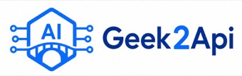

# XAiWebHook

| 赞助商 | 说明 |
| --- | --- |
| <a href="https://www.geek2api.com/?utm_source=fuckclaude&utm_medium=sponsor"></a> | 感谢 [Geek2API](https://www.geek2api.com/?utm_source=fuckclaude&utm_medium=sponsor) 赞助本项目。 |

XAiWebHook 是一个 mirai-console Kotlin 插件，通过 `webhook_config.yml` 配置双向 WebHook：

- Incoming：外部 HTTP 请求触发群/好友消息、HTTP 转发、网页截图或自定义响应。
- Outgoing：群聊和好友消息按规则匹配后执行动作。
- 模板：支持 `${request...}`、`${event...}`、默认值和基础布尔条件。
- 管理：支持 `/xwebhook reload` 与 `/xwebhook status`。

## 快速开始

### 环境要求

- JDK 11。
- mirai-console 2.16.0。
- 网页截图需要 Microsoft Edge、Chrome 或已安装的 Playwright 浏览器。

### 构建与安装

```bash
# Windows
./gradlew.bat buildPlugin

# Linux / macOS
./gradlew buildPlugin
```

插件包生成于：

```text
build/mirai/XAiWebHook-0.2.0.mirai2.jar
```

将 JAR 放入 mirai-console 的 `plugins/` 目录并启动。首次加载会生成：

```text
<mirai 根目录>/config/kim.hhhhhy.x.webhook/webhook_config.yml
```

修改配置后执行：

```text
/xwebhook reload
/xwebhook status
```

运行时配置不会因升级 JAR 自动覆盖。新增配置项或示例变更需要手工同步。

### 浏览器安装

Windows 示例默认复用系统 Edge。没有可用 Chrome/Edge 时可安装 Playwright Chromium：

```bash
./gradlew.bat playwrightInstallChromium
```

插件运行时不会自动下载浏览器。

## 配置入口

- 默认配置与完整注释：[src/main/resources/webhook_config.yml](src/main/resources/webhook_config.yml)
- Geek2Api 公共状态页：[examples/webhook_config.geek2api-status.yml](examples/webhook_config.geek2api-status.yml)
- Geek2Api CLI Bridge 登录：[examples/webhook_config.geek2api-cli-bridge.yml](examples/webhook_config.geek2api-cli-bridge.yml)
- CLI Bridge 协议与安全说明：[docs/CLI_BRIDGE_DESKTOP_INTEGRATION.md](docs/CLI_BRIDGE_DESKTOP_INTEGRATION.md)

启用配置前至少需要：

1. 替换 `change-me-token` 或 `change-me-incoming-token`。
2. 替换示例群号、好友号和发送者 QQ。
3. 只启用实际使用的 endpoint、route 和 action。
4. 确认 `browser.allowed_hosts` 只包含必要域名。

## Geek2Api 公共状态截图

公共 `/status` 页面无需 Geek2Api 账号或 Access Token。完整示例已经配置：

- `hk → hk2 → hk3 → hk4 → hk5` 五个入口自动 failover。
- 等待端点测速及渠道卡片或合法空状态加载。
- 截取完整 `//*[@id="app"]/div[2]/main`。
- 截图时隐藏 fixed header：`#app header`。
- 保留 `monitor-status` part ID，供浏览器查询 API 复用。

核心配置：

```yaml
browser:
  enabled: true
  engine: "chromium"
  channel: "msedge"
  headless: true
  session_cache_enabled: false
  allowed_hosts:
    - "hk.geek2api.com"
    - "hk2.geek2api.com"
    - "hk3.geek2api.com"
    - "hk4.geek2api.com"
    - "hk5.geek2api.com"

actions:
  geek2api-monitor-screenshot:
    type: "send_webpage_screenshot"
    enabled: true
    base_urls:
      - "https://hk.geek2api.com"
      - "https://hk2.geek2api.com"
      - "https://hk3.geek2api.com"
      - "https://hk4.geek2api.com"
      - "https://hk5.geek2api.com"
    group_id: "${request.body.group_id}"
    friend_id: "${request.body.friend_id}"
    screenshot:
      parts:
        - id: "monitor-status"
          url: "https://hk.geek2api.com/status"
          wait_until: "commit"
          steps:
            - op: "wait"
              selector: '//*[@id="app"]/div[2]/main/section[2]/div[2]/div[1]/button'
              state: "visible"
              timeout_ms: 60000
            - op: "wait"
              selector: '(//*[@id="app"]/div[2]/main/div/div/div/button[1] | //*[@id="app"]/div[2]/main//div[contains(concat(" ", normalize-space(@class), " "), " empty-state ")])[1]'
              state: "visible"
              timeout_ms: 60000
          selector: '//*[@id="app"]/div[2]/main'
      delay_before_ms: 3000
      timeout_ms: 60000
      font_wait_timeout_ms: 3000
      hide_selectors: ["#app header"]
      retry:
        enabled: true
        max_retries: 2
        delay_ms: 1000
```

通过 outgoing 触发时，截图会自动发回当前群或好友。通过 incoming 触发时，请求体必须提供 `group_id` 或 `friend_id`，且不能同时提供两者。

## Codex Radar 分数报告

默认配置保留 `send_codex_radar_report` 动作及“降智检测”路由触发方式，但数据源已改为通过 Playwright 访问 `https://codexradar.com/`，读取页面中的“雷达分”和“社区体感分” DOM 区块，并在同一张 PNG 中展示两类分数。

首次启用前确认浏览器配置包含：

```yaml
browser:
  enabled: true
  allowed_hosts:
    - "codexradar.com"

actions:
  codex-degradation-report:
    type: "send_codex_radar_report"
    page_url: "https://codexradar.com/"
    timeout_ms: 60000
    max_wait_ms: 120000
    poll_interval_ms: 1000
    stable_polls: 2
    wait_until: "domcontentloaded"
    cache:
      enabled: true
      file: "codex-radar-cache.json"
      ttl_ms: 900000
      refresh_enabled: true
      refresh_interval_ms: 900000
    send_text: true
    send_chart: true
```

WebHook 服务启动完成后，会对启用缓存的 Codex action 异步预热一次页面数据，只写入缓存，不向群或好友发送消息；`refresh_enabled` 只控制后续定时刷新。无缓存首次请求会在同一个浏览器页面中持续轮询两个区块，最多等待 120 秒；超时后会忽略 `—`、`暂无`、pending 等未完成条目，只要两类仍各有有效分数就生成部分快照、写入缓存并发送带“部分数据”提示的文本/图片。若任一分区完全没有有效分数，才返回失败。命中未过期缓存会立即展示；过期缓存仍先展示，后台刷新失败或超时只记录诊断，不覆盖旧缓存。日志中的 `total/valid/placeholder/pending/final_missing/stable_counts` 可区分页面未完成与源站确实没有样本。

旧版 `efficiency_url`、`insights_url`、IQ 降智判定、预警/推荐和 advice/labels 配置已删除；动作类型、现有 route/action 引用、群/好友目标参数以及 pending/failure、send_text/send_chart 调用方式保持不变。页面结构变化、动态内容超时、分数缺失或越界时会返回明确错误并发送配置中的脱敏失败提示。旧自定义 action 未配置 `cache` 区块时仍走无缓存实时抓取路径。

## Incoming 示例

```yaml
server:
  enabled: true
  host: "127.0.0.1"
  port: 18080
  base_path: "/webhook"

auth:
  type: "bearer"
  tokens: ["change-me-token"]
  allow_empty_for_localhost: false

incoming:
  endpoints:
    - id: "send-group"
      method: "POST"
      path: "/send-group"
      actions:
        - type: "send_group_message"
          group_id: "${request.body.group_id}"
          message: "${request.body.message ?: \"\"}"
        - type: "reply"
          status: 200
          body:
            success: true
```

调用示例：

```bash
curl -X POST http://127.0.0.1:18080/webhook/send-group \
  -H "Authorization: Bearer change-me-token" \
  -H "Content-Type: application/json" \
  -d '{"group_id":123456789,"message":"hello"}'
```

端点自己的 `tokens` 为空时会回退到全局 `auth.tokens`。常见状态码：`401` 鉴权失败、`404` 路径或方法不匹配、`409` 动作组忙、`413` 请求体过大、`500` 动作失败。

## Outgoing 示例

```yaml
outgoing:
  routes:
    - id: "group-message-forward"
      enabled: true
      events: ["group_message"]
      groups: [123456789]
      message:
        contains: ["关键词"]
      actions:
        - type: "http_request"
          method: "POST"
          url: "https://example.invalid/webhook"
          body:
            group_id: "${event.groupId}"
            sender_id: "${event.senderId}"
            message: "${event.messageText}"
```

`events`、`groups`、`friends`、`senders`、`message` 和 `condition` 之间是“与”关系；`message` 内的 `contains`、`starts_with`、`ends_with`、`regex` 之间是“或”关系。

## 核心配置速查

| 区块 | 用途 |
| --- | --- |
| `server` | HTTP 服务地址、端口和路径前缀 |
| `auth` | Incoming Bearer Token 鉴权 |
| `templates` | 模板表达式开关与缺失变量策略 |
| `browser` | 浏览器、超时、白名单和会话缓存 |
| `model_plaza` | Model Plaza 查询功能开关与 URL |
| `incoming.endpoints` | 外部请求入口 |
| `outgoing.routes` | mirai 消息事件匹配规则 |
| `actions` | 可复用命名动作 |
| `security` | 请求体和命令执行安全开关 |
| `logging` | 请求、响应和错误日志 |

支持的动作：

| 动作 | 说明 |
| --- | --- |
| `send_group_message` | 发送群消息 |
| `send_friend_message` | 发送好友消息 |
| `http_request` | 发起 HTTP 请求 |
| `send_webpage_screenshot` | 使用 Playwright 截图并发送图片 |
| `send_codex_radar_report` | 读取 Codex Radar 页面并合成雷达分/社区体感分图片 |
| `query_model_plaza_models` | 匹配所有包含关键词的分组，并分别列出各分组模型 |
| `query_model_plaza_groups` | 匹配所有包含关键词的模型，并分别列出各模型分组 |
| `query_model_plaza_requests` | 访问 `/model-plaza` 查询请求信息；不超过 3 条返回普通图文，超过 3 条返回合并转发 |
| `reply` | 构造 Incoming HTTP 响应 |
| `execute_command` | 执行 mirai-console 命令，默认禁用 |

动作可内联，也可在顶层 `actions` 命名后通过 `ref` 引用：

```yaml
actions:
  notify-admin:
    type: "send_group_message"
    group_id: 123456789
    message: "收到 WebHook"

incoming:
  endpoints:
    - id: "notify"
      actions:
        - ref: "notify-admin"
```

## 模板表达式

常用上下文：

- Incoming：`request.method`、`request.path`、`request.query.*`、`request.headers.*`、`request.body.*`、`request.remoteHost`。
- Outgoing：`event.type`、`event.botId`、`event.groupId`、`event.friendId`、`event.senderId`、`event.senderName`、`event.messageText`、`event.timestamp`。
- 冷却提示：`cooldown.routeId`、`cooldown.scope`、`cooldown.remainingMillis`、`cooldown.remainingSeconds`。

```yaml
message: "${request.body.message ?: \"默认内容\"}"
condition: "contains(${event.messageText}, \"紧急\") && ${event.senderId} != 10000"
```

表达式只支持变量替换、默认值、比较、布尔逻辑以及 `contains`、`startsWith`、`endsWith`，不执行任意脚本。

## 单飞与冷却

`single_flight` 防止同一动作组并发执行。多个入口使用相同 `key` 时共享一把锁：

```yaml
single_flight:
  enabled: true
  key: "geek2api-monitor-screenshot"
  notify: true
  message: "截图任务正在执行，请稍后再试。"
```

Outgoing `cooldown` 支持个人、管理员和路由全局冷却：

```yaml
cooldown:
  enabled: true
  personal_ms: 60000
  administrator_ms: 10000
  global_ms: 5000
  notify: true
  message: "请在 ${cooldown.remainingSeconds} 秒后重试。"
```

冷却和单飞状态只保存在内存中。管理员绕过权限为 `kim.hhhhhy.x.webhook:cooldown-bypass`。

## Model Plaza 查询

通过 outgoing 路由在指定群聊中触发模型、分组和请求记录查询。群成员发送特定消息格式即可查询 Geek2API 模型广场数据：

- **按分组关键词查询模型**：发送 `模型 <关键词>`；例如 `模型 gpt` 会命中 `gpt`、`gptpro`、`gpt-Azure` 等分组，并分别列出各分组拥有的模型
- **按模型关键词查询分组**：发送 `分组 <关键词>`；例如 `分组 gpt` 会命中所有名称包含 `gpt` 的模型，并分别列出各模型所属分组
- **按模型关键词查询请求记录**：发送 `请求 <关键词>`；例如 `请求 gpt` 会命中所有名称包含 `gpt` 的模型，在 `/model-plaza` 页面读取每个模型卡片的吞吐、延迟，并截取该模型的近期成功率图表

支持不区分大小写的子串模糊匹配；同名分组、模型及其关联结果会自动合并去重。

### 配置步骤

1. 启用 Model Plaza 功能并配置 CLI Bridge 认证：

```yaml
model_plaza:
  enabled: true
  base_url: "https://hk.geek2api.com/model-plaza"
  timeout_ms: 30000
  # CLI Bridge 认证配置 — /model-plaza 需要登录后才能访问
  # 使用 CLI Bridge 在系统浏览器中完成授权，无需在配置中保存密码
  auth:
    start_url: "https://hk.geek2api.com/api/v1/auth/cli-bridge/start"
    browser_url: "https://hk.geek2api.com/cli-bridge"
    poll_url: "https://hk.geek2api.com/api/v1/auth/cli-bridge/poll"
    profile_url: "https://hk.geek2api.com/api/v1/user/profile"
    refresh_url: "https://hk.geek2api.com/api/v1/auth/refresh"
    poll_interval_ms: 3000
    max_wait_ms: 300000
    refresh_before_expiry_seconds: 300
    retry_cooldown_ms: 5000
```

**重要说明**：
- `model_plaza.auth` 必须配置，缺少该段将报错提示
- 首次触发查询时会自动启动 CLI Bridge 登录流程：
  1. 插件打开系统默认浏览器，导航到授权页面
  2. 用户在浏览器中通过任意方式（账号密码 / Google / GitHub…）登录 Geek2API 并授权
  3. 授权后令牌缓存至 `<mirai 根目录>/data/kim.hhhhhy.x.webhook/model-plaza-cache/`
  4. 后续查询直接复用缓存令牌，令牌到期前自动静默刷新
- 服务器无桌面环境时，浏览器无法自动打开。此时查看 mirai-console 日志，找到类似 `打开系统浏览器进行授权: https://hk.geek2api.com/cli-bridge?bridge_id=...` 的日志行，在本机浏览器手动访问该 URL 完成授权（5 分钟内有效）

2. 配置 outgoing 路由（已包含在默认配置中）：

```yaml
outgoing:
  routes:
    - id: "model-plaza-query-models"
      enabled: true  # 修改为 true 启用
      events: ["group_message"]
      groups: [123456789]  # 替换为实际群号，留空表示不限制
      message:
        starts_with: ["模型"]
      actions:
        - type: "query_model_plaza_models"
          pending_message: "正在查询分组模型，请稍候..."
          failure_message: "查询失败，请稍后重试"
          empty_message: "未找到包含该关键词的分组"

    - id: "model-plaza-query-groups"
      enabled: true  # 修改为 true 启用
      events: ["group_message"]
      groups: [123456789]  # 替换为实际群号
      message:
        starts_with: ["分组"]
      actions:
        - type: "query_model_plaza_groups"
          pending_message: "正在查询模型分组，请稍候..."
          failure_message: "查询失败，请稍后重试"
          empty_message: "未找到包含该关键词的模型"

    - id: "model-plaza-query-requests"
      enabled: true  # 修改为 true 启用；还需要 browser.enabled: true
      events: ["group_message"]
      groups: [123456789]  # 替换为实际群号
      message:
        starts_with: ["请求"]
      actions:
        - type: "query_model_plaza_requests"
          pending_message: "正在查询模型请求记录，请稍候..."
          failure_message: "查询失败，请稍后重试"
          empty_message: "未找到包含“${query}”的模型"
```

“请求”查询额外依赖浏览器自动化：`browser.enabled` 必须为 `true`，`browser.allowed_hosts` 必须包含 `model_plaza.base_url` 的域名（默认配置已包含 `hk*.geek2api.com`）。它复用“模型/分组”查询已经取得的登录令牌，不会再次打开 CLI Bridge 授权页。

3. 执行 `/xwebhook reload` 重载配置

### 使用示例

在配置的群聊中发送：

```
模型 gpt
```

机器人回复：

```
包含 'gpt' 的分组（共 3 个）:
分组：gpt
- gpt-4
- gpt-5

分组：gptpro
- gpt-4
- gpt-pro

分组：gpt-Azure
- gpt-4
- gpt-azure-chat
```

发送：

```
分组 gpt
```

机器人回复：

```
包含 'gpt' 的模型（共 2 个）:
模型：gpt-4
- gpt
- gptpro
- gpt-Azure

模型：gpt-5
- gpt
```

发送：

```
请求 gpt
```

匹配到 3 个及以下模型时，机器人把所有模型放在同一条消息里，每个模型一段：

```
gpt-4
吞吐: 81.46tok/s 延迟: 19.5s
[成功率图表]

gpt-5
吞吐: 暂无数据 延迟: 暂无数据
图片：暂无数据
```

匹配到 4 个及以上模型时，改为发送一条合并转发消息，转发记录中每个模型独占一个节点，节点内容与上面的单段格式相同。没有匹配到模型时回复 `未找到包含“gpt”的模型`。

### 技术说明

- “模型/分组”查询使用登录 JWT 和原浏览器 Cookie 缓存直连 Geek2API `/api/v1/model-plaza` 接口，不依赖页面 DOM
- 支持 `hk → hk2 → hk3 → hk4 → hk5` 入口 failover，并在 401 时刷新 Token 后重试一次
- 支持自定义 `query_pattern` 参数覆盖默认提取逻辑
- 模糊匹配全部命中项，按分组或模型聚合关联结果并去重
- 支持配置冷却时间和单飞控制避免并发查询
- “请求”查询先用同一接口确定匹配的模型名，再在同一个浏览器页面中打开 `/model-plaza`、填入关键词，逐个读取模型卡片；页面一旦被跳转到 `/model-plaza` 以外会立即停止。若被跳转到登录页（登录态失效），会刷新一次登录令牌后重试，仍失败则回复 `failure_message`
- “请求”查询的失败日志会屏蔽 token、secret、Authorization 头和 JWT，群内只发送 `failure_message`
- 每张模型卡片只会对应一个模型：先按卡片标题精确匹配，再按卡片中单独一行的原始模型名匹配，最后才做完整词边界的模糊匹配，避免 `gpt-4` 借用 `gpt-4o` 的数据
- 吞吐、延迟取自模型卡片底部的指标行（页面默认展示成功率最高、有数据的分组），延迟统一换算为秒；成功率截图保留原图内容，在最外层增加边框，并在边框左侧复制图中右侧可见百分比；整张图片左右各留白约 5% 宽度、上下各留白约 1% 高度（以加留白前的图片尺寸为基准，向上取整且至少 1 像素）
- 某个模型缺少吞吐、延迟或图表时只把对应字段显示为“暂无数据”，其它模型照常返回；搜索框或模型卡片找不到、页面跳转等结构性错误会回复 `failure_message`，不会伪装成“暂无数据”
- 页面结构变化时可在动作中覆盖 `search_selector`、`model_card_selector`、`model_name_selector`、`performance_selector`、`sparkline_selector`、`percentage_selector`；成功率百分比默认按每张卡片的相对 XPath `./div[2]/div[2]/div/span[3]/span` 获取，对应用户提供的完整路径 `//*[@id="app"]/div[2]/div[2]/main/div/div[3]/div[1]/div[2]/div[2]/div/span[3]/span`，也支持直接填写完整 XPath

### 请求记录图片构建配置

图片依次经过：图表/百分比 DOM 截图 → 计算边框、间距和画布尺寸 → 填背景并原样复制截图 → 编码 PNG → 校验截图大小。原图文字、字体、颜色和竖条均由网页提供，合成阶段不缩放、不重绘。

图片样式独立保存在插件配置目录的 `request_image.yml`。首次启动自动生成默认文件并加载；修改保存后，文件内容连续两次检查一致即校验并应用，通常约 1–2 秒生效。只影响后续 `请求` 查询生成的图片，已发送的消息不会被修改；同一次查询中的所有模型使用同一份样式快照。无需重启插件、HTTP 服务或浏览器。

默认配置如下，逐项中文注释见 [src/main/resources/request_image.yml](src/main/resources/request_image.yml)。所有尺寸单位为像素，百分数 `5.0` 表示 5%，不是比例 `0.05`：

```yaml
version: 1
border:
  enabled: true
  width_px: 1
  padding_px: 2
  color: "#FF3B30"
percentage:
  enabled: true
  gap_px: 6
  vertical_align: "center"
margin:
  left_percent: 5.0
  right_percent: 5.0
  top_percent: 1.0
  bottom_percent: 1.0
  min_px: 1
background:
  margin_color: "#FFFFFF"
  content_color: "auto"
output:
  max_pixels: 16000000
```

| 字段 | 含义 | 默认值 | 有效范围/格式 |
| --- | --- | --- | --- |
| `version` | 配置格式版本 | `1` | 仅整数 `1` |
| `border.enabled` | 外框开关；关闭后也不增加边框内边距 | `true` | 布尔值 |
| `border.width_px` | 边框线宽；`0` 不绘制线条 | `1` | 整数 `0–16` |
| `border.padding_px` | 原图与边框之间的内边距 | `2` | 整数 `0–128` |
| `border.color` | 边框颜色 | `"#FF3B30"` | 颜色字符串 |
| `percentage.enabled` | 左侧百分比副本开关；关闭不影响原图中的右侧文字 | `true` | 布尔值 |
| `percentage.gap_px` | 副本与原图外框之间的间距 | `6` | 整数 `0–256` |
| `percentage.vertical_align` | 副本在内容区内的竖向对齐 | `"center"` | `top/center/bottom` |
| `margin.left_percent` / `margin.right_percent` | 左右外边距，以加外边距前的完整内容宽度计算 | 各 `5.0` | 有限数字 `0–50`；`0` 关闭该侧留白 |
| `margin.top_percent` / `margin.bottom_percent` | 上下外边距，以加外边距前的完整内容高度计算 | 各 `1.0` | 有限数字 `0–50`；`0` 关闭该侧留白 |
| `margin.min_px` | 非零比例边距向上取整后的最小像素数 | `1` | 整数 `0–128` |
| `background.margin_color` | 四侧外边距背景 | `"#FFFFFF"` | 颜色字符串 |
| `background.content_color` | 新增间隙和内边距的底色，不覆盖原截图 | `"auto"` | `auto` 取原图左上角像素，或颜色字符串 |
| `output.max_pixels` | 创建合成画布前的最大像素总量 | `16000000` | 整数 `1–64000000` |

颜色采用带引号的 `"#RRGGBB"` 或 `"#AARRGGBB"`，后者 alpha 在前。例如 `"#00000000"` 为全透明。输出固定为 PNG，同时仍受 `webhook_config.yml` 中的 `browser.max_screenshot_bytes` 限制。像素数或字节数超限时只省略该模型的图片，指标和其他模型照常返回。

未能取得百分比元素时，沿用原有降级：保留原图及外边距，不伪造左侧数值或增加外框；主动关闭 `percentage.enabled` 时，边框开关仍可独立生效。图表/百分比选择器、浏览器视口、认证和超时仍使用主配置及动作参数，独立图片配置只负责合成。

**校验与失败处理**：错误类型、越界数字、NaN/Infinity、非法颜色、未知/重复字段、不支持的版本、空/多文档 YAML 或超过 64 KiB 的文件都会被拒绝；缺省字段采用内置默认值，显式 `null` 无效。候选配置整份通过校验后才替换有效值，不会只应用其中几个字段。运行中修改无效或文件被删除时保留上一份有效值，控制台记录原因，`/xwebhook image-config` 和 `status` 可查看错误；修复并保存后自动恢复。新进程首次启动已有无效文件时使用内置有效默认值，同时保留原文件供修复；同一进程内重新启用插件时，仍会保留最后有效样式、修订号和最近成功时间。

**读写方式**：

- 直接编辑配置文件：自动检查并生效，不必执行主配置 `reload`。
- `/xwebhook image-config`：读取当前有效 YAML、文件路径、修订号、监听状态与最近错误。
- `/xwebhook image-config-set margin.left_percent 8`：校验单项更新、保存到文件并立即应用。颜色示例：`/xwebhook image-config-set border.color #22C55E`。
- `/xwebhook image-config-reload`：立即从磁盘重载图片配置，不重启服务。

管理命令继承 `kim.hhhhhy.x.webhook:admin` 权限。代码写入先校验、写同目录临时文件并刷新，然后原子替换配置文件；成功落盘才更新内存。校验/写入失败时文件和当前有效值保持原样；文件系统不支持原子替换时明确报错，不退化为直接覆盖。单项更新在锁内完成读改写，避免并发修改不同字段时互相覆盖。若磁盘文件已经无效或不可读取，单项更新会拒绝执行，保留用户尚待修复的内容；请先修复文件，或通过 `write`/`writeYaml` 明确整体替换。`write` 和 `update` 会重新生成带默认说明的规范 YAML，自定义注释会被替换；`writeYaml` 保留调用方提供的原文及注释。

受信任的依赖插件可使用 `kim.hhhhhy.x.webhook.api.XAiWebHookRequestImageApi`：

| 接口 | 行为 |
| --- | --- |
| `read(): RequestImageStyle` | 当前不可变样式快照 |
| `readYaml(): String` | 当前有效配置的完整 YAML；不是磁盘上尚未通过校验的内容 |
| `status(): RequestImageConfigStatus` | 文件路径、修订号、监听状态、最近成功时间、最近错误 |
| `suspend write(style): RequestImageConfigUpdateResult` | 校验对象、保存并立即应用 |
| `suspend writeYaml(yaml): RequestImageConfigUpdateResult` | 校验 YAML、保存并立即应用 |
| `suspend update(key, value): RequestImageConfigUpdateResult` | 按点分字段路径原子更新，值传字符串 |
| `suspend reload(): RequestImageConfigUpdateResult` | 立即校验并加载磁盘文件，不写文件 |

更新结果含 `success`、`style`、`revision`、`error`；失败时返回仍然有效的样式与修订号。写入/重载使用 IO dispatcher；插件未启动或已停止时返回失败，不会自行启动监听器，只读接口仍可返回默认或最后有效快照。

```kotlin
// 在调用方的协程中执行。修改百分比，不改变同一次查询已经取得的快照。
val current = XAiWebHookRequestImageApi.read()
val result = XAiWebHookRequestImageApi.write(current.copy(
    margin = current.margin.copy(leftPercent = 8.0, rightPercent = 8.0)
))
check(result.success) { result.error.orEmpty() }

// 更新单个字段；与其他字段的并发更新不会互相覆盖。
val updated = XAiWebHookRequestImageApi.update("border.color", "#22C55E")
```

## 命令与权限

| 命令 | 说明 |
| --- | --- |
| `/xwebhook reload` | 重载主配置与图片配置，并重启 WebHook 服务 |
| `/xwebhook status` | 查看服务、路由、浏览器、图片配置修订号和最近错误 |
| `/xwebhook image-config` | 查看当前有效图片配置与自动加载状态 |
| `/xwebhook image-config-set <字段路径> <值>` | 校验、保存并立即应用单项图片配置 |
| `/xwebhook image-config-reload` | 只重载图片配置，不重启 HTTP 或浏览器 |

主要权限：

- `kim.hhhhhy.x.webhook:admin`
- `kim.hhhhhy.x.webhook:execute-command`
- `kim.hhhhhy.x.webhook:cooldown-bypass`

`execute_command` 必须同时开启 `security.allow_command_execution: true` 和动作自身 `enabled: true`。

## 高级能力

### 受保护页面登录

访问 `/keys`、`/monitor` 等受保护页面时，可使用 CLI Bridge、账号密码兼容模式或静态 Token。推荐阅读：

- [CLI Bridge 完整示例](examples/webhook_config.geek2api-cli-bridge.yml)
- [CLI Bridge 协议与安全说明](docs/CLI_BRIDGE_DESKTOP_INTEGRATION.md)

启用 `browser.session_cache_enabled` 会把 token pair、Cookie 和 localStorage 写入磁盘。缓存目录必须限制访问权限。

### 浏览器文本查询 API

依赖插件可通过 `kim.hhhhhy.x.webhook.api.XAiWebHookBrowserApi` 复用命名截图动作的导航、认证和 BrowserContext。API 只接收 action、part 和受限 selector，不接收任意 JavaScript、Cookie 或 Token。

公共状态动作的兼容 part ID 为 `monitor-status`。

## 安全边界

- 生产环境必须替换示例 Token。
- 默认监听 `127.0.0.1`；绑定 `0.0.0.0` 时必须启用强 Token。
- `allow_empty_for_localhost` 只应在回环监听地址使用。
- `browser.allowed_hosts` 只配置必要域名。
- 不要在 YAML 或日志中暴露真实密码、TOTP、Token、Cookie 或 session cache。
- `send_webpage_screenshot` 不支持任意 JavaScript。
- `execute_command` 默认双重关闭。
- 示例群号、好友号和 URL 必须使用占位符后再提交。

## 故障排查

- 服务未启动：执行 `/xwebhook status`，检查端口占用、Token 和配置解析错误。
- 请求返回 401：检查 `Authorization: Bearer <token>`。
- 请求返回 404：检查 `base_path + path` 和 HTTP method。
- 请求返回 409：同一 `single_flight.key` 的任务仍在执行。
- 请求返回 413：请求体超过 `security.max_body_bytes`。
- 网页截图失败：检查 `browser.enabled`、浏览器 channel/路径、`allowed_hosts`、URL 和 selector。
- 公共状态截图异常：确认 selector 为 `//*[@id="app"]/div[2]/main`，并配置 `hide_selectors: ["#app header"]`。
- 字体加载卡住：调低 `screenshot.font_wait_timeout_ms`；超时后会使用当前回退字体继续截图。
- 偶发导航或网络超时：启用 `screenshot.retry`；持续 selector 超时应修正页面就绪条件。
- CLI Bridge 失败：查看 [CLI Bridge 文档](docs/CLI_BRIDGE_DESKTOP_INTEGRATION.md) 中的错误处理。
- 配置修改未生效：执行 `/xwebhook reload`；环境变量变化需要重启 mirai-console。

## 开发验证

```bash
# 普通测试
./gradlew.bat test

# 真实 Edge 浏览器测试
XAI_WEBHOOK_BROWSER_IT=true ./gradlew.bat test --tests "kim.hhhhhy.x.webhook.action.WebPageScreenshotActionTest"

# 公共状态页真实截图测试
XAI_WEBHOOK_GEEK2API_STATUS_IT=true ./gradlew.bat test --tests "kim.hhhhhy.x.webhook.action.WebPageScreenshotActionTest.publicGeek2ApiStatusConfigurationCapturesMainWithoutHeaderWhenExplicitlyEnabled"

# 构建插件包
./gradlew.bat clean buildPlugin
```
